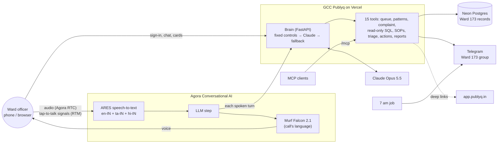

# GCC Publyq

**Talk to your ward's complaints. In English, Tamil or Hindi. It answers, and it gets the work done.**

Live at **[gcc.publyq.in](https://gcc.publyq.in)** · Built for *Build with Agora (Bengaluru)*, Theme 2: *Voice AI at Work, Beyond the Call Center*

---

## The problem

Chennai residents report broken drains, garbage and dangling cables by tagging the Greater Chennai Corporation
(GCC) on X. Each post becomes a complaint in GCC's portal. In Ward 173 (Adyar), the records show the work is stuck:

- **90 of 96 open complaints have never been touched** by an officer.
- **95 of 96 are past their deadline.**
- **One post, the ward's Assistant Engineer, holds 80 of them**, and typically waits about 200 hours before acting.
- **1 in 5 "fixed" complaints comes back.**

The data exists. What's missing is a way for the person in the field to know, in their own language and without
digging through a portal, *what matters today*, act on it, and close the loop.

## First principles

We started from the user, not the data: a junior Assistant Engineer on a street, phone in one hand, switching
between Tamil, English and Hindi. Everything follows from five rules.

1. **Voice first.** Talking is the main way in. The home screen is one big mic button; typing is the backup.
2. **Your work, not all the data.** Every answer is about *your* post: field staff see what they hold, leaders also see
   what their team holds.
3. **Facts come from records.** Every number, ID and post comes from GCC's own data. If the data can't answer, it says so.
4. **People make the changes.** The assistant can only *propose* an action. Nothing is recorded or sent until you say
   "confirm", and that word is checked by plain code, never by the AI.
5. **Honest about limits.** GCC's portal can't be updated by outside apps, so actions are recorded here and shared on
   Telegram, and the app says so.

## What you can do

| You say | It does |
|---|---|
| "What's on my plate?" | Your open complaints, most urgent first, with the reason |
| "Open the first one" · "Show me 185 OET" | The full complaint: details, photos, officer actions, who holds it, who it escalates to |
| "How do I fix this?" | GCC's standard procedure and the complaint's priority |
| "What keeps coming back?" | Streets where the same problem returns after being "fixed" |
| "A resident called about an open manhole near the school in Gandhi Nagar" | Type, priority, the post that owns it, and possible duplicates |
| "Escalate it" → "Confirm" | Records the escalation, posts it to the ward's Telegram group, and sets a follow-up |
| "Which street has the most open drain complaints?" | Writes its own read-only database query and answers |

It can also **assign, add a note, set a follow-up, request a status change, request closure, or ask for help**,
always as propose → confirm. Every morning at **7 am** a brief goes to the ward's Telegram group: for each officer,
their most dangerous, oldest and recurring complaint, each one tap from the app.

## How a call works

1. **Sign in with Telegram.** Only members of the Ward 173 Telegram group get in.
2. **Pick your post** once (Assistant Engineer, Sanitary Inspector, Executive Engineer, …). You can change it any time.
3. **Tap the big mic** to start a call. As soon as it connects, it's listening: just speak.
4. **Tap again to send.** After that, tap to speak and tap again to send. Only what you say between two taps is heard,
   so street and office noise never becomes a question.
5. **Listen to the answer** while the details appear on screen as cards.
6. **Speak any of the three languages.** Switch from English to Tamil to Hindi mid-call; the answer, the voice and the
   screen follow you.
7. **End call** is its own button. The conversation is saved in your History.

## How it works



- **Agora carries the voice.** The browser joins an Agora channel; Agora's agent hears the turn (ARES listens for all
  three languages at once), sends the words to our brain, and speaks the answer with a Murf voice. Audio never passes
  through our server.
- **The brain decides.** "Confirm" and "cancel" (and சரி, हाँ, வேண்டாம், नहीं) are handled by fixed code. Everything else goes to
  Claude, which looks things up with our tools. The language of your words decides the language of the reply.
- **The tools are the only way to touch data.** The voice agent, the chat and outside AI assistants (through MCP) use
  the same tools with the same rules.
- **Telegram is how actions reach people.** Confirmed escalations and requests are posted to the ward's group, and
  every message is logged, including failed ones.

The first spoken word usually comes in about **1 second**: the assistant says "Let me check…" while it looks things up.
Design details: [ARCHITECTURE.md](ARCHITECTURE.md).

## Tool stack

| Part | What we use | Why |
|---|---|---|
| Voice call | **Agora Conversational AI** + **Agora RTC** Web SDK 4.24 + **Agora RTM** 2.3 | Real-time voice; RTM carries the tap-to-talk signals |
| Speech-to-text | **Agora ARES**, `en-IN,ta-IN,hi-IN` in one call | Nobody has to pick a language |
| Text-to-speech | **Murf Falcon 2.1**, Anisha, in the caller's language | Natural Indian voice, streamed |
| AI brain | **Claude Opus 5.5**, official Anthropic Python SDK | Reasons with tools and writes its own read-only queries |
| Backend | **Python 3.12 + FastAPI** on **Vercel** (US-East) | Streams answers; sits next to Claude and the database |
| Database | **PostgreSQL on Neon** | Records, actions, conversations, accounts |
| Sign-in and messaging | **Telegram** (Login Widget + Bot API, @Publyqbot) | Where ward staff already are |
| Analytics | **app.publyq.in** deep links | Lists and maps without rebuilding them |
| Integrations | **MCP server** at `/mcp` | Any MCP-compatible assistant can use the same tools |
| Frontend | Plain HTML, CSS and JavaScript, no build step | Fast on phones; light and dark mode |

## The data

Real GCC records for **Ward 173 (Adyar, zone 13), January–November 2026**:

| What | Rows |
|---|---|
| Complaints (with Tamil translations, safety flags, repeat-spot clusters) | 455 |
| Officer actions on those complaints | 512 |
| Photos and videos (links to GCC's portal and X) | 1,326 |
| GCC posts and reporting lines (posts, not named people) | 761 / 892 |
| Standard operating procedures | 56 |

The source CSVs are in [`data/complaints/`](data/complaints) and [`data/officials/`](data/officials). Photo and video files are not stored here.

## Security and privacy

- **Sign-in:** Telegram, members of the Ward 173 group only, re-checked daily. The session is a random token in a
  cookie scripts can't read; the database stores only a hash of it.
- **Your history is yours:** each conversation belongs to the account that started it. Nobody else can read it,
  continue it, call into it, or confirm actions in it.
- **The AI can't change data or read chats:** its queries run as a read-only database user that has no access to
  conversations, with a 3-second limit and 50 rows; functions that could escape that user are blocked.
- **Secrets stay on the server:** every key lives in environment variables ([`.env.example`](.env.example)). The voice
  agent, the 7 am job and MCP each need their own token, and an unset token turns its endpoint off.
- **The browser is locked down:** the page can't be embedded in other sites, HTTPS is forced, and private API answers
  are never cached.

## Run it yourself

```bash
./backend/scripts/dev-db.sh start                          # local Postgres on port 5444
cp .env.example .env                                       # fill in the keys you have
python3 -m venv .venv && .venv/bin/pip install -r requirements-dev.txt
.venv/bin/python -m backend.scripts.seed                   # load the Ward 173 records
.venv/bin/uvicorn backend.app.main:app --port 8173 --reload
```

Open http://localhost:8173. Telegram sign-in only works on the domain set in BotFather (`/setdomain`), and voice needs
a public `PUBLIC_BASE_URL` that Agora can reach, so full end-to-end testing happens on the deployed site.

**Tests:** `.venv/bin/pytest`. 134 tests, including replays of every attack fixed so far; they never call paid APIs
or send real messages.

**Deploy:** pushing to `main` deploys to Vercel. Schema changes go to Neon with
`python -m backend.scripts.apply_schema` (adds what's missing, never drops anything); a first full copy of the data
uses `python -m backend.scripts.migrate_db`.

**Connect an MCP client** (for example Claude Code):

```bash
claude mcp add --transport http gcc-publyq https://gcc.publyq.in/mcp --header "Authorization: Bearer $MCP_TOKEN"
```

## Project layout

```
backend/app/        brain and tools
  agent.py          one turn: fixed controls → Claude with tools → fallback
  lang.py           which language the person is speaking
  tools.py          complaints, officials, procedures, actions, reports
  dbquery.py        the AI's read-only SQL
  roles.py          GCC posts and who sees what
  auth.py           Telegram sign-in and sessions
  voice.py          Agora + Murf call setup, push to talk
  brief.py          the 7 am morning brief
  telegram.py       sending and logging Telegram messages
  publyq.py         links into app.publyq.in
  mcp.py            MCP server
  main.py           web API and who may touch what
backend/db/         Postgres schema
backend/scripts/    local Postgres, seed data, apply schema, copy to Neon, link Telegram,
                    evaluate LLMs, fetch ward photos and X media
backend/tests/      134 tests
api/index.py        Vercel entry point
web/                the app (one page, no build step)
data/complaints/    Ward 173 complaints, officer actions, media manifests
data/officials/     GCC posts, reporting lines, procedures, ward map
```

## Known limits

- **Snapshot data:** records are from 15–20 Nov 2026; Publyq's live views can drift from them.
- **No GCC write-back:** GCC's portal has no API for outside apps.
- **Posts are self-chosen:** sign-in proves you're in the ward group, not which post you hold.
- **Three-language calls are new:** automatic switching and the Hindi voice need more real calls to be proven.

## What's next

- **Proof of fix:** require a before/after photo with location to close a complaint (1 in 5 come back today).
- **Personal briefs:** send each officer their own morning message in their language.
- **Reply to citizens:** answer the original post on X when a fix is confirmed.
- **Live data:** switch from the November snapshot to Publyq's daily feed.
- **GCC portal write-back:** the one integration only GCC can unlock.
