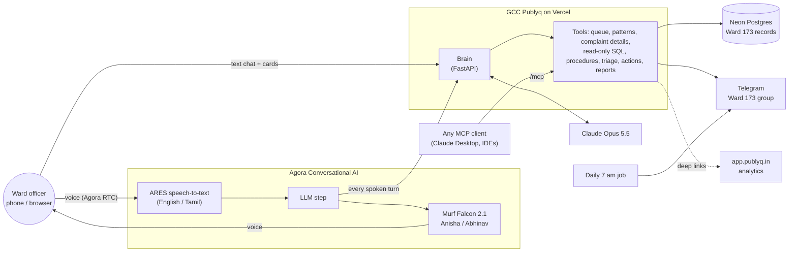

# GCC Publyq

**A voice assistant that helps Chennai Corporation staff get real work done on public complaints, hands-free, in English or Tamil.**

Live at **[gcc.publyq.in](https://gcc.publyq.in)** · Built for *Build with Agora (Bengaluru)*, Theme 2: *Voice AI at Work, Beyond the Call Center*

---

## The problem

Citizens in Chennai report problems (broken drains, garbage, dangling cables) by tagging the Greater Chennai
Corporation (GCC) on X. Each post becomes a complaint in GCC's portal. In Ward 173 (Adyar), the records show
where things get stuck:

- **90 of 96 open complaints have never been touched** by an officer.
- **95 of 96 are past their deadline.**
- **One post (the ward's Assistant Engineer) holds 80 of them**, and typically waits about 200 hours before acting.
- **1 in 5 "fixed" complaints comes back.**

The staff don't lack information. What's missing is a way to start the day knowing what matters, act on it
quickly, and close the loop.

## What GCC Publyq does

You **talk to it like a colleague**, by voice or text, and it does the work.

| You can… | For example |
|---|---|
| **Find information** | "What's urgent for me?" · "Show me complaint 185 OET" · "Who handles this?" |
| **Solve problems** | It reads the standard procedure, works out who is responsible and who to escalate to, and spots repeat problems. |
| **Automate routine work** | It sorts new reports by type, priority and owner, flags duplicates, writes reports, and sends a morning brief every day. |
| **Finish whole tasks** | "Escalate it" → "Confirm" → it records the action, posts to the ward's Telegram group, and sets a follow-up. |

### It knows who you are
Pick your post when you start (Assistant Engineer, Sanitary Inspector, Executive Engineer, …) or just say
*"As the Assistant Engineer (Electrical)…"*. Every answer is about **your** work: field staff see what they hold,
leaders also see everything their team holds.

### A typical day
1. **7:00 am:** a **morning brief** arrives in the ward's Telegram group, in Tamil. For each officer it lists the
   most dangerous, the oldest and the recurring complaint. Every complaint ID is a link.
2. **Tap a link:** GCC Publyq opens in your role and language, with the brief already asked.
3. **Tap the mic and talk:** *"What should I look at first?"* It answers in natural Chennai-office Tamil (or English),
   with the complaint details, photos and the official procedure on screen.
4. **Act:** *"Escalate it."* It shows exactly what it will do. *"சரி"* (OK) confirms it.
5. **Follow up:** the escalation is posted to Telegram, a follow-up is scheduled, and a completion report is ready.

### It's honest
- Every fact comes from GCC's own records. If the data can't answer a question, it says so.
- Nothing is recorded or sent until you confirm. Saying "confirm" (or சரி) is handled by fixed code, never by the AI.
- GCC's portal has no way for outside apps to update it. So actions are **recorded in GCC Publyq and shared on
  Telegram**, and the app always says so.

---

## How it works



**In plain words:**

1. **Your voice travels over Agora.** Agora's voice agent turns your speech into text, sends it to our brain, and reads
   the answer back with a Murf voice. Audio never passes through our server, which keeps it fast.
2. **The brain decides what to do.** "Confirm" and "cancel" are handled by fixed code. Everything else goes to Claude,
   which uses our tools to look things up and can write its own read-only database queries for open-ended questions.
3. **The tools are the only way to touch data.** The same tools serve the voice agent, the chat and outside AI
   assistants (through MCP), so they all follow the same rules.
4. **Actions reach people on Telegram.** Escalations, help requests and close-out requests are posted to the
   ward's group once you confirm. Every message is logged, including failed ones.
5. **Publyq shows the bigger picture.** Every list and complaint links straight into the matching view on
   [app.publyq.in](https://app.publyq.in).

The first answer word usually arrives in about **1 second**: the assistant says "Let me check…" while it looks things up.

Deeper design notes: [ARCHITECTURE.md](ARCHITECTURE.md).

---

## Tool stack

| Part | What we use | Why |
|---|---|---|
| Voice conversation | **Agora Conversational AI** + **Agora RTC** (Web SDK 4.24) | Real-time voice with turn-taking and interruptions handled for us |
| Speech-to-text | **Agora ARES** (`en-IN`, `ta-IN`) | Agora's own engine; it supports Indian English and Tamil |
| Text-to-speech | **Murf AI Falcon 2.1**: Anisha (English + Tamil), Abhinav (English) | Natural Indian voices |
| AI brain | **Claude Opus 5.5** via the official Anthropic Python SDK | Strong reasoning and tool use; it writes and checks its own database queries |
| Backend | **Python 3.12 + FastAPI** | Streams answers to the voice agent and the browser |
| Database | **PostgreSQL on Neon** (local Postgres for development) | All complaint records, officials, procedures and the action history |
| Hosting | **Vercel** (functions in US-East) + a daily Vercel Cron job | Sits next to Claude and the database for fast tool calls |
| Messaging | **Telegram Bot API** (@Publyqbot) | Where ward staff already talk |
| Analytics | **app.publyq.in** deep links | Lists, maps and accountability views without rebuilding them |
| Integrations | **MCP server** at `/mcp` | Lets any MCP-compatible AI assistant use the same tools safely |
| Frontend | Plain HTML/CSS/JavaScript, no build step | Fast on phones; uses Publyq's design (light and dark mode) |

---

## The data

Real GCC records for **Ward 173 (Adyar, zone 13), January–November 2026**:

| What | Rows |
|---|---|
| Complaints (with Tamil translations, safety flags, repeat-spot clusters) | 455 |
| Officer actions on those complaints | 512 |
| Photos and videos (links to GCC's portal and X) | 1,326 |
| GCC posts and reporting lines (posts, not named people) | 761 / 892 |
| Standard operating procedures | 56 |

The raw CSVs are in [`Complaints/`](Complaints) and [`Officials/`](Officials). Photo and video files themselves are
not stored in this repository.

---

## Safety built in

- **Two-step actions:** propose, then confirm. The AI can't confirm on its own.
- **Read-only investigations:** the AI's database queries run as a read-only user, are cut off after 3 seconds,
  and are capped at 50 rows. Private chat history is off-limits.
- **Secrets stay out of the code:** all keys live in environment variables (see [`.env.example`](.env.example)).
- **Protected endpoints:** the voice agent, the 7 am job and the MCP server each need their own secret token.
- **Everything is logged:** every conversation turn, action and Telegram message.

---

## Run it yourself

```bash
./scripts/dev-db.sh start                                  # local Postgres on port 5444
cp .env.example .env                                       # fill in the keys you have
python3 -m venv .venv && .venv/bin/pip install -r requirements-dev.txt
.venv/bin/python -m backend.scripts.seed                   # load the Ward 173 records
.venv/bin/uvicorn backend.app.main:app --port 8173 --reload
```

Open http://localhost:8173. Without API keys it still works: text chat answers from built-in rules, and voice and
Claude turn on as you add keys.

**Tests:** `.venv/bin/pytest` (91 tests; they never call paid APIs or send real messages).

**Deploy:** pushing to `main` deploys to Vercel. Data moves to Neon with
`python -m backend.scripts.migrate_db`, which refuses to overwrite existing data and checks every table afterwards.

**Connect an MCP client** (for example Claude Code):

```bash
claude mcp add --transport http gcc-publyq https://gcc.publyq.in/mcp --header "Authorization: Bearer $MCP_TOKEN"
```

---

## Project layout

```
backend/app/        brain and tools
  agent.py          one conversation turn: fixed controls → Claude with tools → fallback
  tools.py          complaints, officials, procedures, actions, reports
  dbquery.py        the AI's read-only SQL
  roles.py          posts and who sees what
  voice.py          Agora + Murf call setup (English / Tamil)
  brief.py          the 7 am morning brief
  telegram.py       sending and logging Telegram messages
  publyq.py         links into app.publyq.in
  mcp.py            MCP server
  main.py           web API
backend/scripts/    load data, move it to Neon, link the Telegram group, test LLMs
backend/tests/      91 tests
web/                the app people use (one page, no build step)
Complaints/, Officials/   Ward 173 source data
```

---

## What's next

- **Proof of fix:** require a before/after photo with location to close a complaint (1 in 5 currently come back).
- **Personal briefs:** send each officer their own morning message, once everyone signs in with their phone number.
- **Reply to citizens:** answer the original post on X when a fix is confirmed.
- **Live data:** switch from the November snapshot to Publyq's daily feed.
- **GCC portal write-back:** the one integration only GCC can unlock.
